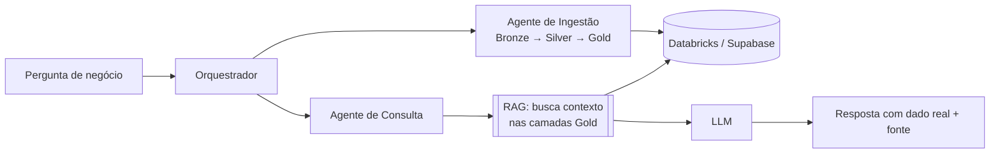
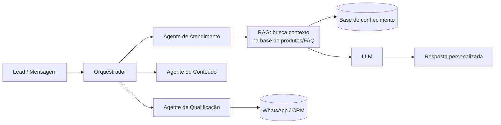

# Olá, eu sou o Vitor Marinho 👋

### Engenheiro de IA & Dados | Agentes de IA · RAG · LLMs | Python · PySpark · Databricks · Azure · AWS

[](https://www.linkedin.com/in/vitor-marinho)
[](https://vitormarinho.vercel.app)
[](mailto:vtechdata.solutions@outlook.com.br)
[](https://agient.com.br)


---

## 👨‍💻 Sobre mim

Engenheiro de IA & Dados com experiência construindo desde a base, com pipelines **ETL/ELT escaláveis** e arquitetura **Lakehouse (Medallion)** em Azure e AWS, até a camada de inteligência por cima dela: agentes de IA orquestrados com **RAG** consultando esses mesmos dados em tempo real.

Atuei em projetos reais com grandes volumes de dados nos setores de **saúde (oncologia)** e **mineração e metalurgia**, desenvolvendo soluções ponta a ponta, da ingestão nas camadas Bronze, Silver e Gold até a disponibilização para times de Analytics, Ciência de Dados e áreas de negócio.

- 🔭 Atualmente buscando novas oportunidades como **Engenheiro de IA & Dados**
- 🚀 Fundador da [Agient](https://agient.com.br), estúdio de automação e IA para comércio local
- 🌱 Estudando **inglês** e aprofundando conhecimentos em **AWS e MLOps**
- 💬 Aberto a oportunidades **CLT e PJ**, remoto ou híbrido
- 📍 Taquaritinga, SP, Brasil

---

## 🤖 Orquestração Multi-Agente: IA & Dados 

Aplico o mesmo princípio de orquestração aos meus próprios pipelines de dados: um orquestrador central distribui a tarefa entre agentes especializados, e o agente de consulta usa **RAG** para buscar contexto real nas camadas Gold antes de qualquer resposta chegar ao LLM. A resposta parte do dado real, não da memória do modelo.



## 🤖 Orquestração Multi-Agente: IA & Marketing 

O mesmo padrão, aplicado agora a atendimento e geração de demanda: o agente de atendimento usa **RAG** sobre a base de produtos e FAQ da empresa para responder ao lead com informação real, enquanto os agentes de conteúdo e qualificação atuam em paralelo, cada um dentro do seu próprio contexto.



---

## 🚀 Produtos que Construí 

Projetos próprios, no ar, do início ao fim: arquitetura, backend, frontend e deploy.

| Projeto | Descrição | Link |
|---|---|---|
| **ARIA** | Agente de IA com RAG sobre dados reais (Databricks + Supabase), suporte à decisão em saúde | [Demo](https://agient-aria-health.vercel.app) · [Código](https://github.com/VitorSMarinho/agient-aria-health) |
| **Lazer Livre** | Marketplace de espaços para eventos, em produção | [Demo](https://lazer-livre.vercel.app) |
| **VITRX OS** | Plataforma full-stack de operações de segurança | [Demo](https://vitrixsecuritystaff.vercel.app) |

---

## 🛠️ Tecnologias & Ferramentas

### IA & Agentes


### Linguagens


### Cloud & Plataformas


### ETL/ELT & Pipelines


### Banco de Dados


### DevOps & CI/CD


### Monitoramento


---

## 🚀 Projetos em Destaque

### 🏥 Setor: Saúde (Oncologia/Hematologia)

| Projeto | Descrição | Tecnologias |
|---|---|---|
| **Migração Synapse → Microsoft Fabric** | Transição completa de workloads analíticos com foco em governança, segurança e validação de integridade pós-migração | Fabric, Synapse, PySpark, RBAC |
| **Automação de Ingestão via E-mail** | Pipeline automatizado para captura de anexos via Logic Apps, armazenamento em Data Lake e transformação nas camadas raw/silver | Logic Apps, Data Factory, PySpark |
| **Sustentação e Otimização de Pipelines** | Monitoramento contínuo, resolução de incidentes e otimização de performance em ambiente com dados volumosos | Azure Monitor, Log Analytics, SQL |

### ⛏️ Setor: Mineração e Metalurgia

| Projeto | Descrição | Tecnologias |
|---|---|---|
| **Estruturação de Dados a partir de Planilhas Excel** | Consolidação de dados descentralizados em planilhas para camadas Bronze/Silver/Gold, apoiando a área financeira na tomada de decisão | PySpark, Data Factory, Delta Lake |

---

## 🏗️ Arquitetura que domino

```
Fontes de Dados          Ingestão              Processamento           Consumo
─────────────           ─────────             ─────────────           ───────
SAP          ──►                              ┌─ Bronze (Raw)
SharePoint   ──►   Azure Data Factory   ──►  ├─ Silver (Cleaned)  ──► Analytics
Excel        ──►   Logic Apps                └─ Gold (Aggregated)     BI / DS
APIs         ──►   PySpark / Databricks                               Negócio
```

---

## 📊 GitHub Stats


---

## 📚 Certificações em Progresso

- 🔄 **Databricks Certified: Associate Data Engineer**
- 🔄 **Microsoft Certified: Azure Data Engineer Associate (DP-203)**
- 🔄 **Big Data e Analytics na Prática**

---

## 🎯 Objetivo

Construir soluções de dados e agentes de IA escaláveis, confiáveis e orientados ao negócio. Acredito que dados bem estruturados são a base tanto para decisões estratégicas quanto para agentes de IA que realmente entregam valor.

---

> "Dados bem estruturados não são um produto de TI, são uma vantagem competitiva."

---

⭐ **Aberto a oportunidades: CLT ou PJ | Remoto ou Híbrido**
