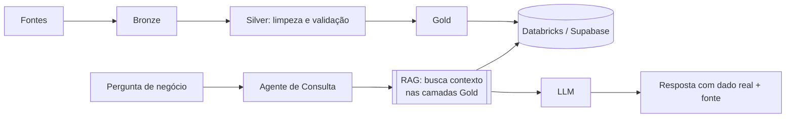

# Olá, eu sou o Vitor Marinho 👋

### Engenheiro de Dados & IA | Databricks · PySpark · Delta Lake · Azure · Microsoft Fabric | RAG

[](https://www.linkedin.com/in/vitor-marinho)
[](https://vitormarinho.vercel.app)
[](mailto:vtechdata.solutions@outlook.com.br)

---

## 👨‍💻 Sobre mim

Engenheiro de Dados desde 2023, construindo pipelines **ETL/ELT** e **Data Lakes no Azure** (**Synapse Analytics, Data Lake Storage Gen2, Data Factory**) e **Lakehouses em Databricks** (PySpark, Delta Lake, Medallion), com governança sob **LGPD**. Na **CBMM**, tratei dados do **SAP** em Databricks com **Unity Catalog**, da camada raw até o consumo no Power BI. Conduzi a migração de um ambiente de dados para um **novo tenant Azure**, de Dev a Prod, e atuei na POC do **Microsoft Fabric** com a Microsoft.

Atuei em projetos reais com grandes volumes de dados nos setores de **saúde (A.C.Camargo Cancer Center, oncologia)** e **mineração e metalurgia (CBMM)**, desenvolvendo soluções ponta a ponta, da ingestão nas camadas Bronze, Silver e Gold até a disponibilização para times de Analytics, Ciência de Dados e áreas de negócio.

Nos projetos recentes levo essa base para a IA: pipelines que alimentam **RAG** e agentes, com dado vetorial em PostgreSQL/pgvector. A resposta do modelo parte do dado real, e dado real precisa ser confiável.

- 🔭 Buscando oportunidades como **Engenheiro de Dados**
- 🌱 Estudando **inglês** e aprofundando conhecimentos em **AWS e MLOps**
- 💬 Aberto a oportunidades **CLT e PJ**, remoto ou híbrido
- 📍 Taquaritinga, SP, Brasil

---

## 🚀 Projetos em Destaque

### 🏥 A.C.Camargo Cancer Center: Saúde (Oncologia)

| Projeto | Descrição | Tecnologias |
|---|---|---|
| **Migração de tenant Azure** | Mapeamento completo do ambiente antigo (Synapse, pipelines, triggers, tabelas, Storage, Key Vault, acessos por usuário), migração gradual de Dev, Prod tabela a tabela e validação de paridade de linhas, tamanhos e tipos de arquivo; esteira CI/CD reconfigurada | Synapse, Storage, Key Vault, Azure DevOps, SQL |
| **Microsoft Fabric: POC e governança** | POC com a Microsoft e o time de Arquitetura: configuração inicial, workspace do projeto, documentação de governança (nomenclatura, padrões, acessos por nível) e habilitação de engenheiros pleno e sênior | Microsoft Fabric, RBAC |
| **Automação de Ingestão via E-mail** | Pipeline automatizado para captura de anexos via Logic Apps, armazenamento no Data Lake e transformação nas camadas raw/silver | Logic Apps, Data Factory, Data Lake Storage Gen2, Azure Synapse |
| **Sustentação e Otimização de Pipelines** | Notebooks PySpark e SQL pools no Azure Synapse sobre origens Oracle e o Data Warehouse do cliente: monitoramento contínuo, resolução de incidentes e otimização de performance com dados volumosos | Azure Synapse, PySpark, SQL pools, Oracle, Azure Monitor, Log Analytics |

### ⛏️ CBMM: Mineração e Metalurgia

| Projeto | Descrição | Tecnologias |
|---|---|---|
| **Lakehouse SAP: custo de produção e suprimentos** | Dados do SAP (Material Ledger e MM), orçamento via catálogo federado e preços de mercado tratados da camada raw até as views dos relatórios Power BI. Padrão de higiene do cliente implementado em funções PySpark reutilizáveis (chave MD5, metadados, soft delete), dimensões na camada de serviço, manutenção dos jobs de orquestração, validação de linhagem via information_schema e gestão das entregas em sprints no Azure Boards (tasks, horas, relatório semanal ao cliente) | Databricks, Unity Catalog, PySpark, Delta Lake, Databricks Jobs, Power BI, Azure DevOps |

### 🧪 Projetos próprios

| Projeto | Descrição | Status |
|---|---|---|
| **ARIA** | Pipeline Medallion em Databricks sobre dados clínicos fictícios, alimentando um agente de IA com RAG (Supabase + pgvector) | Em breve |
| **payments-data-harness** | Harness para produtos de dados de pagamentos com dados públicos do Banco Central: qualidade como portão, guardrails de PII/PCI e aprovação humana antes da camada gold | Em desenvolvimento · [Código](https://github.com/VitorSMarinho/payments-data-harness) |

---

## 🏗️ Arquitetura que domino

```
Fontes de Dados          Ingestão              Processamento           Consumo
─────────────           ─────────             ─────────────           ───────
SAP          ──►                              ┌─ Bronze (Raw)
SharePoint   ──►   Azure Data Factory   ──►  ├─ Silver (Cleaned)  ──► Analytics
Excel        ──►   Logic Apps                └─ Gold (Aggregated)     BI / DS / IA
APIs         ──►   PySpark / Databricks                               Negócio
```

---

## 🛠️ Tecnologias & Ferramentas

### Engenharia de Dados & Plataformas


### Linguagens


### Cloud


### Banco de Dados


### DevOps, CI/CD & Monitoramento


### IA aplicada a dados


---

## 🤖 Dados que alimentam IA

O agente de consulta usa **RAG** para buscar contexto real nas camadas Gold antes de qualquer resposta chegar ao LLM. Por isso a qualidade da IA depende da qualidade do pipeline.



---

## 📚 Certificações em Progresso

- 🔄 **Databricks Certified: Associate Data Engineer**
- 🔄 **Microsoft Certified: Azure Data Engineer Associate (DP-203)**
- 🔄 **Big Data e Analytics na Prática**

---

## 🎯 Objetivo

Construir soluções de dados escaláveis, confiáveis e orientadas ao negócio. Acredito que dados bem estruturados são a base tanto para decisões estratégicas quanto para uma IA que realmente entrega valor.

---

> "Dados bem estruturados não são um produto de TI, são uma vantagem competitiva."

---

⭐ **Aberto a oportunidades como Engenheiro de Dados: CLT ou PJ | Remoto ou Híbrido**
